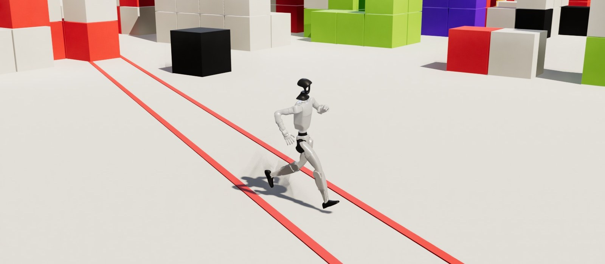
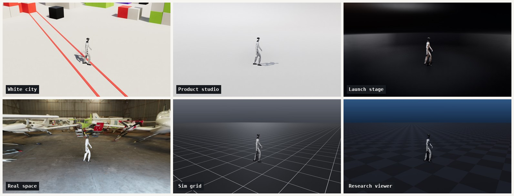

# MotionBricks G1



Real-time generative motion in threepipe with [NVIDIA MotionBricks](https://github.com/NVlabs/motionbricks) ([paper](https://arxiv.org/abs/2604.24833)).
The Unitree G1 model runs in the browser with ONNX Runtime Web (WebAssembly), in a Web Worker so it never stalls the frames.
Click the floor and the robot walks or runs there, or drive it with WASD or the arrow keys (relative to the camera, Shift to run). Every frame of motion comes from the model; there are no animation clips at runtime.

The default scene, White city, is after Mirror's Edge and Sixty Four: an off-white world that fades into the background with no horizon, clusters of cubes and stepped platforms around a plaza, red for the runner lane and the strongest accents, a low warm sun with crisp shadows, and screen-space GI for the colour that bounces off the white. The camera looks down from high up with a narrow field of view. Five more styles follow the looks robotics teams use for demos; pick one in the Scene menu or with `?style=`.



The webgi plugins add screen-space reflections, screen-space GI, contact shadows, temporal AA (with a velocity buffer for the moving robot) and a light bloom, at strengths set by each style. The Effects button, or `?fx=0`, turns them off for slower GPUs.

## How it works

MotionBricks fills in the motion between four recent poses (the context) and one to four target poses, choosing a duration of 6 to 16 tokens (0.6 to 1.9 s at 30 Hz).
Longer motion comes from chaining generations.

The motion comes from the [three-motionbricks](../../plugins/three-motionbricks) library, which works with any three.js scene. This example adds the threepipe parts:

| File | Role |
| --- | --- |
| `script.ts` | Viewer, render plugins, the Tweakpane panel, floor picking, WASD, camera follow, wander, and the page UI. |
| `G1Stage.ts` | The six scene styles: floor, backdrop, blocks, fog, environment, lights, camera and effect strengths. |

## Model sources

By default the example streams the original `mmm_v6_g1_fp32.onnx` (730 MB) from NVIDIA's GitHub LFS, and the robot GLB that ships with three-motionbricks. Override them with URL parameters:

- `?model=<url>` an original MotionBricks G1 `.onnx` file, or a folder (ending in `/`) with a pack from `tools/pack_model.py`
- `?robot=<url>` a G1 GLB with the MJCF body names, such as the library's `assets/unitree_g1.glb`
- `?style=city|studio|stage|hangar|grid|research` the scene style
- `?backend=webgpu` to try ONNX Runtime's WebGPU backend. With onnxruntime-web 1.30 it computes this model wrongly (the robot sinks, sprints, or walks away from its goal), so WebAssembly is the default
- `?worker=0` to run the model on the page instead of a worker, which stalls rendering during each generation
- `?environment=<url>` the HDR environment map
- `?fx=0` to start with the screen-space effects off

Pages can set the same keys, plus `ort` and `wasm`, on `window.MOTIONBRICKS_CONFIG`.

`tools/pack_model.py` (in the library) shrinks the model to about 190 MB: large weights become int8 with an fp16 scale per 64 values, and the browser expands them back to fp32 external data before creating the session. It also stores a DOUBLE constant as FLOAT, because the WebGPU build of ONNX Runtime Web has no CPU kernel to cast it. 8-bit weights change some of the model's discrete token choices, so the motion differs from fp32 (as fp16 and TF32 also do), but it stays plausible.

```bash
pip install onnx onnxruntime numpy scipy
python plugins/three-motionbricks/tools/pack_model.py mmm_v6_g1_fp32.onnx pack/
```

## Performance

A generation takes about 0.2 to 0.6 s on one WebAssembly thread, depending on the CPU. It runs in `MotionBricksWorker.ts`, and the controller starts each one ahead of playback, so the robot never waits. On the page's own thread the same work would freeze rendering mid-stride on every generation, which reads as a limp. The model needs about 1.5 GB of memory while the session is created, so this is a desktop demo.

## Licenses

- MotionBricks code: Apache 2.0. The ONNX models: [NVIDIA Open Model Agreement](https://www.nvidia.com/en-us/agreements/enterprise-software/nvidia-open-model-agreement/).
- The G1 description and meshes are Unitree's, under BSD-3-Clause (the library's `assets/LICENSE-unitree.txt`).
- The library's `tools/make_bricks.py` seeds the gaits with NVIDIA's sample clips, which are under the NVIDIA Sample Data Evaluation License. The gait targets it ships are the model's own output after several chained generations, and no clip data ships.
