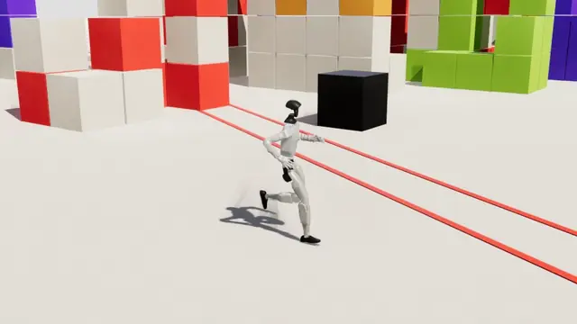
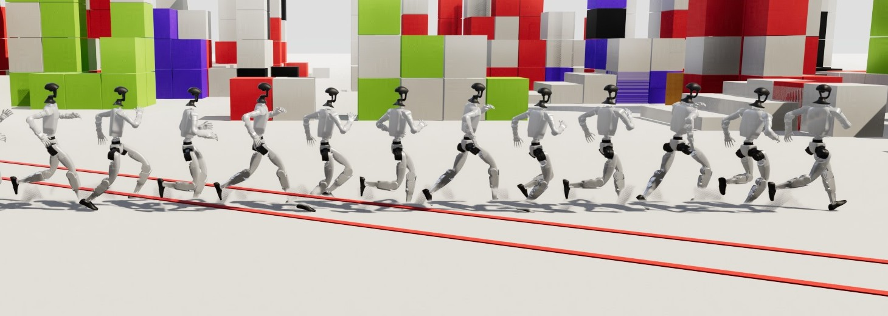
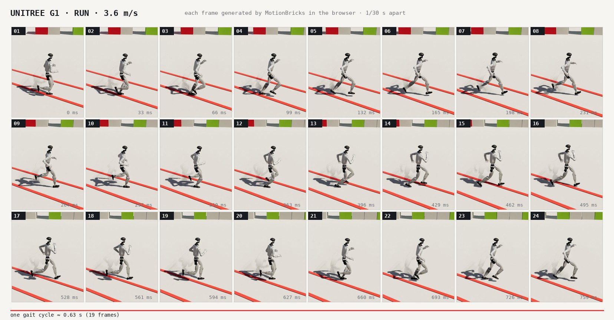
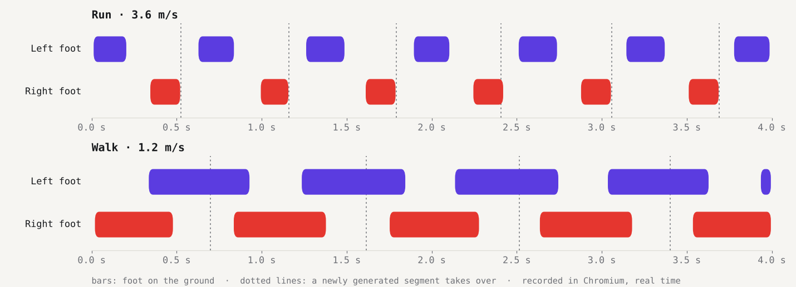

# three-motionbricks

[](https://repalash.com/three-motionbricks/city/)

**[Try it live](https://repalash.com/three-motionbricks/)**: [White city](https://repalash.com/three-motionbricks/city/) · [Seven bodies](https://repalash.com/three-motionbricks/bodies/) · [Playground](https://repalash.com/three-motionbricks/playground/) · [Plain three.js](https://repalash.com/three-motionbricks/plain/). The model downloads once (194 MB on phones, 190 MB on desktops) and is cached after that.

[NVIDIA MotionBricks](https://github.com/NVlabs/motionbricks) for three.js: a Unitree G1 robot that walks and runs where you send it, with every frame of its motion generated in the browser by the model. No animation clips play at runtime.

<p align="center"></p>

It needs only `three`, and works with any three.js setup (plain three.js, react-three-fiber, [threepipe](https://github.com/repalash/threepipe)). ONNX Runtime Web is imported at runtime from a URL, and the model runs in a Web Worker, so inference never stalls rendering.

```bash
npm i three-motionbricks
```

Or without a bundler, from jsDelivr in an import map:

```html
<script type="importmap">
{"imports": {
  "three": "https://cdn.jsdelivr.net/npm/three@0.168.0/build/three.module.js",
  "three/addons/": "https://cdn.jsdelivr.net/npm/three@0.168.0/examples/jsm/",
  "three-motionbricks": "https://cdn.jsdelivr.net/gh/repalash/three-motionbricks@v0.1.0/dist/index.mjs"
}}
</script>
```

```js
import * as THREE from 'three'
import {GLTFLoader} from 'three/addons/loaders/GLTFLoader.js'
import {MotionBricksCharacter, MOTIONBRICKS_DEFAULTS} from 'three-motionbricks'

const g1 = new MotionBricksCharacter()
// Load the robot with any loader: assets/unitree_g1.glb ships with the package.
g1.setRobot((await new GLTFLoader().loadAsync(MOTIONBRICKS_DEFAULTS.robot)).scene)
scene.add(g1.object)
await g1.load((stage, loaded, total) => console.log(stage, loaded, total))

g1.moveTo(new THREE.Vector3(3, 0, -2))        // walk there and stop
g1.moveTo(new THREE.Vector3(-4, 0, 1), 'run')

// Every frame: steer with a world direction while a key is held (or null), then update.
g1.drive(wasdDirection, shift ? 'run' : 'walk')
g1.update(clock.getDelta())
```

`example/index.html` is a complete plain three.js page: click the floor, or drive with WASD.

## Motion, frame by frame

The model is given four recent poses and a target pose, and fills in 0.6 to 1.9 s of motion between them. The controller asks for the next stretch while the current one plays, from frames that are already planned, so the new motion takes over without a seam.

A chronophotograph, after Étienne-Jules Marey: the robot every 0.2 s of one run, laid on a single plate.



A plate after Eadweard Muybridge's *Animal Locomotion*: 24 consecutive frames, 1/30 s apart, as the model generated them.



And when each foot is on the ground, recorded in Chromium in real time. The dotted lines are where each newly generated segment took over; the gait runs through them.



## Options

| Option | Default |
| --- | --- |
| `model` | NVIDIA's original `mmm_v6_g1_fp32.onnx` (730 MB). A folder (ending in `/`) with a pack from `tools/pack_model.py` is about 190 MB. |
| `liteModel`, `lite` | A pack from `tools/pack_lite.py` (194 MB), whose weights stay 8-bit in memory: the session settles near 0.5 GB instead of 1.5 GB or more, so it fits on phones; generation takes about 0.8 s on one thread instead of 0.5 s. `lite: 'auto'` (default) uses it on phones, tablets and devices with 4 GB or less. |
| `ort` | onnxruntime-web 1.30.0 from jsDelivr: its WebAssembly-only build, or the WebGPU build for `backend: 'webgpu'`. |
| `backend` | `'auto'`: WebGPU where the browser has it and the device has memory to spare, if a warm generation takes no more than `gpuLimitMs` (300); otherwise WebAssembly. `'wasm'` or `'webgpu'` force one. With onnxruntime-web 1.30's WebGPU build, both models compute the same motion as on WebAssembly (to 0.01 mm). |
| `worker` | `true`. With `false` the model runs on the page and each generation stalls rendering. |
| `cache` | `true`: model packs are kept in the browser's Cache Storage (`'three-motionbricks'`, or a name you give), so they download once rather than on every visit and page. A changed `pack.json` replaces the cached pack. `false` always downloads. |
| `shadows` | `true`: the robot's meshes cast and receive shadows. |

## The human model (SOMA)

NVIDIA also trained MotionBricks on the 30-joint SOMA human skeleton. `rig: 'soma'` runs that model on the same controller (moveTo, drive, jumps and sitting), on a mannequin or on a humanoid character:

```js
const human = new MotionBricksCharacter({rig: 'soma'})   // NVIDIA's 758 MB SOMA model, or a pack folder
human.setMannequin()                                     // or setCharacter(gltf.scene, CHARACTER_RIGS.mixamo)
scene.add(human.object)
await human.load()
human.drive(direction, 'run')
```

`MotionBricksSOMA` is the engine: a port of NVIDIA's SOMA encoding, decoding and endpoint correction, checked against a NumPy port of their kernels (`tools/motionbricks_soma_ref.py`) to 0.005 mm and 0.05°. Poses are local transforms of `SOMA_SKELETON`, the 77-joint skeleton of NVIDIA's USD (the model drives 30 of them). The packs from `tools/pack_model.py` and `pack_lite.py` work as for the G1 (1.5° and 2.9° from fp32). `SOMA_BRICKS` holds the standing pose, the walk (1.5 m/s) and run (4.6 m/s) targets and their stride cycles, baked by `tools/make_soma_bricks.py` and `make_soma_cycles.py`; left and right steps land within 1-4% of each other in time, as in NVIDIA's own clips. A character's rig maps its bones to SOMA joints through `SOMA_PARTS`.

## Jumps, vaults, ducking and sitting

NVIDIA's [Smart Primitives](https://github.com/NVlabs/motionbricks/blob/main/docs/smart_primitive_editor.md) place a few target poses around an obstacle; the model generates the motion through them. Load one, put it in the world, and the robot uses it on its way:

```js
const box = await g1.loadPrimitive('jump_0_5m')    // a box 0.55 m wide, 0.39 m high: jumped
const wall = await g1.loadPrimitive('jump_0_75m')  // a wall 1.57 m long, 0.64 m high: vaulted
const bar = await g1.loadPrimitive('avoidance')    // a bar at head height: ducked under (the SOMA ones are larger)
const stool = await g1.loadPrimitive('sit')        // a stool 0.31 m high: g1.sit(obstacle), g1.standUp()
g1.setObstacles([
    {primitive: box, position: new THREE.Vector3(0, 0, -4)},
    {primitive: wall, position: new THREE.Vector3(0, 0, -9), rotation: 0},
])
```

`position` is the centre of the primitive's box (`primitive.box.size` is its width, depth and height), and `rotation` turns it about Y; a wall's long side runs along its X. When the robot heads at an obstacle, the controller picks the sequence whose starting speed is closest to the robot's, turns and slides it to the approach the way NVIDIA's runtime does, and generates through its steps. The documents and the clip frames the targets come from load from [NVIDIA's repository](https://github.com/NVlabs/motionbricks) (`G1_PRIMITIVE_SOURCES`): the clips are under NVIDIA's Sample Data Evaluation License, so this package ships none of them.

## The robot

`assets/unitree_g1.glb` (6 MB, 165k triangles) is Unitree's G1 description and meshes in one GLB, built by `tools/build_g1_glb.mjs`. `MOTIONBRICKS_DEFAULTS.robot` points to it on jsDelivr. Its nodes are named after the MJCF bodies, so you can swap its materials, or load your own model with the same node names, and `setRobot` poses it.

## What is inside

| Export | Role |
| --- | --- |
| `MotionBricksCharacter` | The robot, the model and the controller behind `moveTo`, `drive`, `stop` and `update`. |
| `MotionBricksG1` | The engine: a port of NVIDIA's G1 runtime that prepares the ONNX inputs, decodes the output into world space, smooths the root and corrects the endpoints. It has no three.js dependency and runs in Node too. |
| `MotionBricksRemote` | The engine in a Web Worker, behind the same `generate()` call. |
| `G1Controller` | Point-to-point locomotion that generates each segment ahead of playback. Each gait target is the pose of the stride the robot will be at when it arrives, from a left/right symmetric stride cycle, so the steps stay even. |
| `G1Robot` | Poses a loaded G1 model from 36 joint coordinates. |

The images here are rendered with [threepipe](https://github.com/repalash/threepipe) from poses recorded in the browser, in the White city scene of its [MotionBricks example](https://github.com/repalash/threepipe/tree/master/examples/motionbricks-g1).

`tools/` holds the scripts that build the robot GLBs (`build_g1_glb.mjs`, and `build_robot_glb.mjs` for any MJCF), pack the model (`pack_model.py`, and `pack_lite.py` for phones), bake the gait targets and stride cycles (`make_bricks.py`, `make_cycles.py`), and the NumPy reference the engine was checked against (`motionbricks_ref.py`, to within 0.001°).

## Development

```bash
npm install
npm run build     # dist/index.mjs, dist/motionbricks.worker.js and the .d.ts files
npm run serve     # opens example/
```

`dist/` is committed so tagged versions load from jsDelivr's GitHub CDN.

The GitHub Pages site comes from `site/`: the landing page, the Seven bodies world (`site/bodies/`), and the White city world, whose `site/city/app.js` is [threepipe's motionbricks-g1 example](https://github.com/repalash/threepipe/tree/master/examples/motionbricks-g1) bundled with esbuild. `.github/workflows/pages.yml` packs the model both ways and runs `tools/build_site.sh`, which also adds the plain example. To try it locally, pack the model into `_site/model/` and `_site/model-lite/` and serve `_site/`:

```bash
npm run build && tools/build_site.sh
python tools/pack_model.py mmm_v6_g1_fp32.onnx _site/model
python tools/pack_lite.py mmm_v6_g1_fp32.onnx _site/model-lite
npx serve _site
```

## Licenses

The code is Apache 2.0. The MotionBricks ONNX models are under the [NVIDIA Open Model Agreement](https://www.nvidia.com/en-us/agreements/enterprise-software/nvidia-open-model-agreement/), and the G1 description and meshes are Unitree's, under BSD-3-Clause (`assets/LICENSE-unitree.txt`). The gait targets and stride cycles in `G1Bricks.ts` are the model's own output, seeded from NVIDIA's sample clips. Smart Primitives and their clips are read from NVIDIA's repository at runtime; the clips are under the [NVIDIA Sample Data Evaluation License](https://github.com/NVlabs/motionbricks/blob/main/assets/motions/LICENSE.txt).
