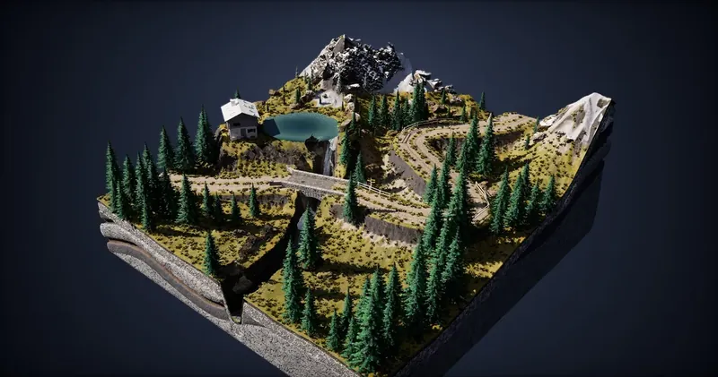
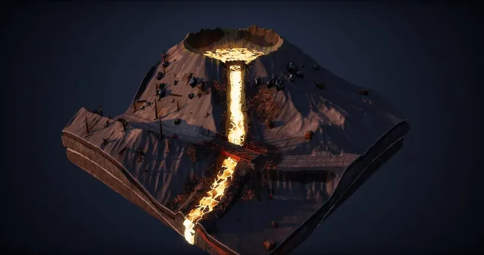
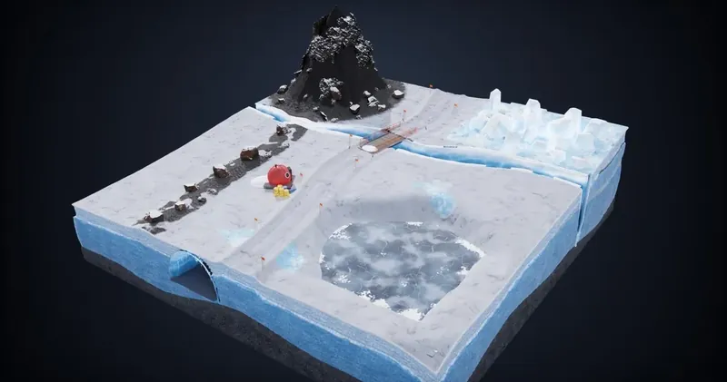
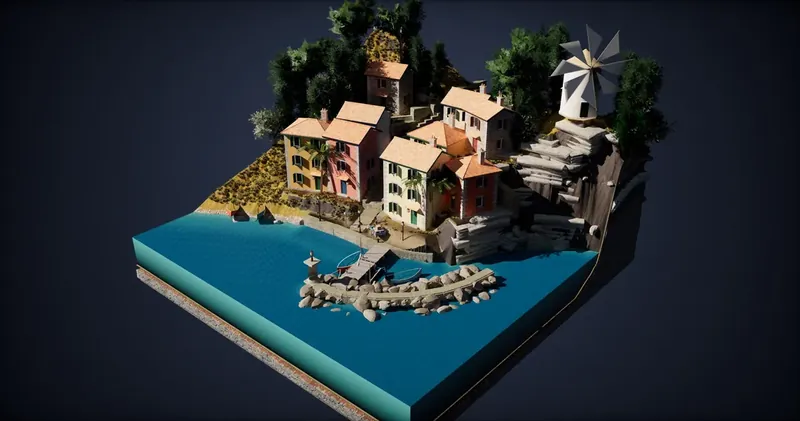
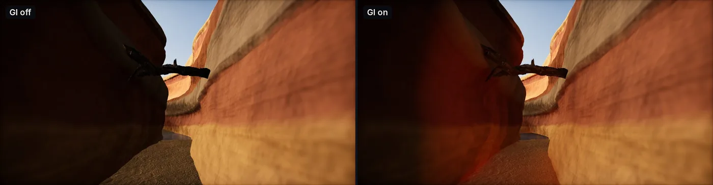

---
prev:
  text: 'Frame Updates: last, debounce, throttle'
  link: './frame-updates'

next: false

aside: false
pageClass: miniature-worlds-page

description: How we built 14 miniature world tiles in code with a coding agent on threepipe and the webgi plugins, and how to build your own with the miniature-worlds starter.
head:
  - - meta
    - property: og:type
      content: article
  - - meta
    - property: og:title
      content: Build miniature worlds with a coding agent
  - - meta
    - property: og:description
      content: How we built 14 miniature world tiles in code with a coding agent on threepipe and the webgi plugins, and how to build your own with the miniature-worlds starter.
  - - meta
    - property: og:image
      content: https://files.threepipe.org/p/miniature-worlds/img/og.jpg
  - - meta
    - property: og:image:alt
      content: Nine miniature world tiles on a dark backdrop
  - - meta
    - name: twitter:card
      content: summary_large_image
  - - meta
    - name: twitter:image
      content: https://files.threepipe.org/p/miniature-worlds/img/og.jpg
---

# Build miniature worlds with a coding agent

This guide shows how we built 14 miniature world tiles with Claude Opus 5.5 on threepipe and the *webgi* plugins, and
how you can build your own with the same kit. Everything runs in the browser: the land is generated at load time,
and the light is computed in real time.

<figure class="mw-video">
  <video autoplay muted loop playsinline preload="metadata" poster="https://files.threepipe.org/p/miniature-worlds/img/poster.jpg" aria-label="Video: the miniature world tiles turning on a dark backdrop">
    <source src="https://files.threepipe.org/p/miniature-worlds/video/miniature-worlds-1600.mp4" type="video/mp4">
  </video>
  <figcaption>The tiles, recorded live in the browser (17 s).</figcaption>
</figure>

- The tiles, each with a still, its GI effect and a live link: [files.threepipe.org/p/miniature-worlds](https://files.threepipe.org/p/miniature-worlds/)
- The live demo (pick a tile in the menu): https://files.threepipe.org/p/ssgi-worlds/demo/
- The starter: [repalash/miniature-worlds](https://github.com/repalash/miniature-worlds) (Apache-2.0), and
  [its build, live](https://files.threepipe.org/p/miniature-worlds/starter/)

## The stack

| Part | What it does | Licence |
|---|---|---|
| [threepipe](https://threepipe.org) | A three.js framework: viewer, materials, plugins, loaders, serialization | Apache-2.0 |
| [*webgi* plugins](https://webgi.dev) (`@threepipe/webgi-plugins`) | SSGI (screen-space global illumination), SSR, TAA, bloom, depth of field, velocity buffer | See the package |
| The world kit (in the starter) | Terrain, erosion, cut-away sides, scatter, trees, grass, water, procedural materials, the look | Apache-2.0 (a few files MIT) |
| Your coding agent | Writes a tile as TypeScript, renders stills, fixes what it sees | |

One stack does the modelling, the materials and the lighting. The agent never moves files between a modelling tool
and a renderer, so what it renders in its stills is what the page shows.

## What a tile is

A tile is a square of land, about 40 m across, with cut-away sides that show its rock and soil layers. It sits on a
studio backdrop in the overview, and has eye-level views where the sky and the land round it take over.

<div class="mw-grid">
  <figure>
    
    <figcaption>Alpine Pass, the example tile in the starter.</figcaption>
  </figure>
  <figure>
    
    <figcaption>Volcano Rim: the lava is the main light.</figcaption>
  </figure>
  <figure>
    
    <figcaption>Glacier Crevasse: the cut faces show the ice.</figcaption>
  </figure>
  <figure>
    
    <figcaption>Harbour Cove, a later tile built from the prop library.</figcaption>
  </figure>
</div>

In code a tile is one object:

```ts
export const alpine: Tile = {
    label: 'Tile: Alpine Pass',
    setup: async({viewer, rig}) => {
        // build the land, the water, the plants and the props into viewer.scene
        return {
            views: {'Diorama': ..., 'Bridge': ..., 'Tarn': ...},   // named cameras, the first is the overview
            times: {'Late morning': ..., 'Alpenglow': ...},       // named lighting presets
            animate: (t) => { /* moving water */ },
            credits: 'Rock scans, ground textures and skies: Poly Haven (CC0). Everything else generated at runtime.',
        }
    },
}
```

The example tile in the starter, the Alpine Pass, is 1,365 lines: a thin scene file (`src/tiles/alpine.ts`) and
four part files in `src/tiles/alpine/`:

- `terrain.ts`: the landform as a height function (a peak, a ridge, a cirque with a tarn, a gorge), the road and the
  creek as paths, the named features (`PEAK`, `TARN`, `HUT`), and the paint rule that picks a ground layer per
  vertex from height, slope and erosion.
- `materials.ts`: snow, granite, timber and stone as GLSL on threepipe's `PhysicalMaterial`.
- `scatter.ts`: density rules for spruces, scrub at the tree line, grass, flowers and boulders.
- `props.ts`: the arch bridge, the hut, snow poles, rails, a signpost, a cairn.

## The kit

The kit is the part an agent reuses for every tile. Each file starts with a comment that explains it.

| Need | Kit |
|---|---|
| Land | `buildTerrain` (`terrain.ts`): a heightfield from a function, droplet and thermal erosion (`erosion.ts`), four Poly Haven ground layers blended per pixel by a paint rule |
| Cut-away sides | `buildCutFaces` (`beds.ts`): rock beds that dip and fold, hard beds as ledges; `strata.ts` for canyon walls |
| Placing things | `scatterOnTerrain` + `instance` (`scatter.ts`): seeded placement by a density rule, one draw call per mesh |
| Plants | `buildConifers` (`conifer.ts`), `buildTufts` (`tufts.ts`), `grassTufts.ts` |
| Water | `buildPond`, `buildCreek` (`freshwater.ts`), `waterBody.ts` (a level per place: paddies, pools, falls) |
| Built things | `TintBatch` (`batch.ts`) and `geo.ts` shapes, merged per material; `architecture.ts` for facades |
| Surfaces | `procMaterial` (`proc.ts`): world-space GLSL, so merged meshes need no UVs and nothing repeats |
| The land beyond | `buildVista` (`vista.ts`): terrain to the horizon for the eye-level views; `heightFog.ts` |
| The look | `stageWorld`, `applyTime` (`stage.ts`): sun, sky fill, backdrop, tone mapping, depth of field, grade |

## Set up

You don't need to set anything up by hand. Start your coding agent (Claude Code, Codex, Cursor or another) in an
empty folder, or in a web session, and send the prompt below: it names the starter, and the agent clones it,
installs it and reads its instructions first. Attach your reference images to the message, or put them in `ref/`
once the agent has cloned the starter.

The starter's `AGENTS.md` (read by Claude Code through `CLAUDE.md`) gives the agent the tile contract, the
conventions, the staging rules, the commands to check its frames, and the frame budget. Keep a browser tab with a GPU
on the dev server it starts: you judge the look there.

::: details Set up by hand (for developers)
```bash
git clone https://github.com/repalash/miniature-worlds
cd miniature-worlds
npm install
npm run dev     # http://localhost:5173/?tile=alpine
```
Then start your agent in that folder and send the prompt. The first line of the prompt sees the starter is already
there and skips the clone.
:::

## The prompt

Fill in the angle brackets and send this as the first message, with one or more reference images (a photo you took,
a CC0 photo, or a concept image):

```text
Build a miniature world tile with the starter https://github.com/repalash/miniature-worlds (threepipe and the webgi
plugins): <theme, e.g. a desert mesa with a slot canyon and a timber water tower>, after my reference images (look
at them first).

Setup: if this folder isn't the starter yet, clone it (git clone https://github.com/repalash/miniature-worlds, then
work inside miniature-worlds/), run npm install, and start npm run dev; tell me its URL so I can watch the tile in my
browser. Save my reference images in ref/.

Read AGENTS.md, README.md, src/types.ts and the example tile (src/tiles/alpine.ts and src/tiles/alpine/) end to end
before you write code.

The tile
- Id <id>, label "Tile: <Name>", in src/tiles/<id>.ts with its parts in src/tiles/<id>/ (terrain, materials,
  scatter, props), registered in src/tiles/index.ts.
- A 40 m square of land with cut-away sides that show its layers.
- Views: "Diorama" (studio backdrop, three-quarter view from above, the whole tile) and 3 to 4 eye-level views with
  the sky, framed like a game level or a film still.
- Times of day: <e.g. late afternoon and golden hour>.
- The GI effect the light is staged for: <e.g. orange bounce from the sunlit canyon wall into the shaded slot>.
- Hero details that reward a close-up: <2 or 3 named props>.

Rules
- Generate in code what looks good generated (terrain, rock beds, water, buildings, fences, plants). Outside
  assets only under CC0 or MIT (Poly Haven through the kit), each named in the credits string. No new npm
  dependencies.
- Use the kit. Do not change what an existing kit function does; add an option or a new file.
- Every view at most 33 ms per frame with GI on at 2016x1010 on <your machine>. No shader program with
  runnable false. No console errors.

Loop
- Blockout first (terrain, cut faces, the Diorama view, the sun), then materials, scatter, props, the eye-level
  views, the times of day. After each step run npm run typecheck, then npm run shot for the views you touched
  (--off 1 when the light changed). Look at every still, crop to check detail, compare with the reference, and fix
  the largest defect.
- Finish the tile at high quality. Stop and report rather than ship weak parts.

Report in short plain sentences: what is procedural, which assets with licences, the GI effect and the on/off still
that shows it, frame times per view (or what I should measure in my tab), still paths, what still falls short.
```

This is the brief our tile agents ran in October 2026, rewritten for the starter's paths and commands. Our agents
also had their own browser tab on a GPU and a deploy script; the starter replaces those with `npm run shot`
(headless, on the CPU) and your own tab.

## The follow-ups

The first prompt gets a tile. The follow-ups make it good. What worked for us:

- **Name the defect and the fix, with numbers.** This is a real pass-2 message to one of our agents, shortened:

  > Oil field: the desert ground reads as a quilted, lumpy duvet in the Diorama (ripples far too tall and
  > regular); make it wind-packed sand with fine ripples, tyre tracks, oil stains, gravel pads under the machines.
  > [...] Make daylight GI visible (sun on the tanks bouncing onto the sand, darker undersides).
  > Mesa: cliffs are smooth lumpy blobs; add hard ledges, vertical fracture joints, talus aprons, desert varnish
  > streaks, overhangs and fallen blocks. [...] Get the Bridge view under 33 ms.
  > Farm: strengthen the red barn bounce (sun angle that lights the barn wall and leaves the yard in its shade).

  The agent's next report: the Mesa Bridge view went from 30.1 ms to 16.9 ms, and the barn's red bounce "now
  shows clearly in the on/off pair".
- **Hold the budget per view.** The Alpine Switchbacks view looks down onto ground that fills the frame, so every
  SSGI ray marches its full length. It measured 34.5 ms; the agent made that one view trace two rays instead of
  four (30.9 ms).
- **One pass, then a review.** Ask for a report after each pass and look at the stills yourself before the next.

## How to iterate

1. **Stills.** `npm run shot -- --tile <id> --views "Diorama,Bridge" --off 1` writes a converged still per view,
   with GI on and off, and prints the page's console errors. The agent opens each still and compares it with the
   reference. Headless Chromium renders on the CPU, so use few frames (`--frames 8`) and `--shadow 512` while
   blocking out.
2. **GI on and off.** Every tile is staged for one GI effect, and the on/off pair proves it. Our staging rules:
   one strong sun, a low sky fill (0.05 to 0.15), a large sunlit surface next to shaded surfaces that receive its
   light (screen-space GI sees only the screen), covered spaces next to sunlit floors, walls with thickness. In the
   page, the "Compare split" slider shows the left half without GI.

   <figure>
     
     <figcaption>Desert Mesa, the slot canyon. The sun lights only the upper wall; with GI its orange light reaches the lower walls and the floor.</figcaption>
   </figure>
3. **Frame time.** In your GPU tab, press "Measure frame time" (or run `await miniWorld.measureFrameTime()`). It
   orbits the camera a little, so every frame does its full work, and reports the median and p90 GPU time.
4. **Budgets.** Our budget is 33 ms per frame (30 fps) at 2016x1010 with GI on, for every view, on an Apple M4 Pro.
   When a view is over: fewer SSGI rays for that view, SSR off where it adds little, fewer far instances, the
   cheaper terrain shader.

## Seeds, parameters and hand edits

Everything in a tile is a function of seeds and parameters in its files. Nothing is stored in a binary scene file.

- **Seeds.** All randomness comes from `rng(seed)` and `new Noise2(seed)`. Each generator has its own seed (in the
  Alpine Pass: spruces 11, scrub 12, grass 21, flowers 22, boulders 31), so you can reroll the grass and keep every
  tree where it was.
- **Parameters.** Counts, sizes and colours are arguments in the tile's files (`spruceRule(85)`, `count: 6000`
  grass tufts, the snow line height). The agent changes a number, reloads, and renders a still.
- **Hand edits.** A placed feature is a named constant (`HUT = {x: -21.6, z: 4.2, rot: 1.0, ...}`) or a path's
  control points (`ROAD`, `GORGE`). The generators read them: the height function carves the road, the scatter
  rules keep trees off the road and out of the camera corridors. Move the hut by editing its constant and the land
  and the forest follow, while every other seed stays the same.
- **How far it scales.** The Alpine Pass asks its density rules for 121 trees, 6,000 grass tufts, 900 flower
  tufts, 74 rocks and up to 1,800 far trees. You steer them by rule (thinner near the tree line, none on
  the road), not one by one.
- **Not built yet:** moving an object in the browser and saving that edit, so a regenerated tile keeps it.
  threepipe has picking, pivot controls and scene JSON; storing such edits as overrides by placement id, applied
  after the generator, is one way to add it.

## Receipts

From the Claude Code run logs and the agents' reports, October 16 and 17, 2026. All tiles were built by Claude
Opus 5.5 agents in Claude Code, three in parallel, each in its own git worktree with its own browser tab on the
owner's Apple M4 Pro.

| Agent | Tiles | Agent time | Tool calls |
|---|---|---|---|
| A | Alpine Pass, Volcano Rim, Autumn Forest Road, Glacier Crevasse | 3 h 14 min (2 runs) | 127 in run 2; run 1 not recorded |
| B | Desert Mesa, Oil Field, Open-Pit Mine, Farm, a second pass on all four, Moon Outpost, Neon Town | 3 h 25 min (3 runs) | 304 in run 1, 164 in run 3; run 2 not recorded |
| C | Switchback Savanna, Rice Terraces, Backwater Bayou, Spring Falls | 2 h 39 min (2 runs) | 79 in run 2; run 1 not recorded |

- 14 tiles in 9 h 18 min of agent time, 3 h 26 min of wall-clock time over two sittings. The first runs stopped at
  the plan's weekly usage limit and were resumed the next morning.
- The Alpine Pass and the shared tile kit it added were committed 1 h 14 min after its agent started.
- A later restyle of every tile into a white bead look (`?style=bead` in the demo) took one agent 44 min and 153
  tool calls.
- Cost in tokens or dollars: not recorded. Effort level: not recorded.

Frame times, GPU ms per frame with GI on at 2016x1010 on the Apple M4 Pro, the minimum of repeated runs (other
agents shared the GPU):

| Tile | Views (ms) |
|---|---|
| Alpine Pass | Diorama 25.1, Bridge 24.9, Under the arch 25.5, Tarn 26.6, Hut 24.4, Switchbacks 30.9 |
| Volcano Rim | 17.9 to 25.3 |
| Autumn Forest Road | 16.8 to 26.9 |
| Glacier Crevasse | 17.2 to 22.3 |
| Desert Mesa (pass 2) | 11.3 to 18.3 |
| Oil Field (pass 2) | 15.5 to 28.4 |
| Rice Terraces | 13.3 to 22.0 |
| Backwater Bayou | 10.8 to 14.7 |
| Spring Falls | 18.9 to 20.9 |
| Switchback Savanna | 17 to 34 (busy GPU) |
| Farm (pass 1) | 9.5 to 17.1 |
| Open-Pit Mine (pass 1) | 14.7 to 19.3 |
| Moon Outpost, Neon Town | 23.6 to 39.9 under heavy GPU load; not proven under 33 ms |

- 33 ms is 30 fps. These are the demo build with the newer SSGI; the starter's published plugins can differ.
- Phone frame rates: not measured.
- Load time per tile: not recorded.

## Asset licences

- Generated at load time, in code: the terrain, rock beds, snow, water, trees, grass and flowers, every building,
  bridge, vehicle and animal in the tiles, and their materials.
- From outside, all CC0 or MIT: Poly Haven HDRI skies, ground textures and scanned rocks and plants (CC0), and in
  some tiles trees generated with EZ-Tree (MIT). The Alpine Pass uses Poly Haven only: two skies, four ground
  textures and five rock scans.
- The Poly Haven files load from a copy on threepipe cloud, as the Poly Haven API terms ask applications to host
  their own copy. Use your own host for a product (`src/kit/assets.ts`).
- Code: the starter is Apache-2.0; its GLSL noise library is MIT ("Golden Temple" by Leon Lin), and the erosion
  loop follows Sebastian Lague's MIT implementation. The starter's `THIRD_PARTY_NOTICES.md` lists all of it.

## Share yours

Build with `npm run build` (a static site in `dist/`), host it anywhere, and post the link with your prompt, your
follow-ups, the time it took and your frame times.
